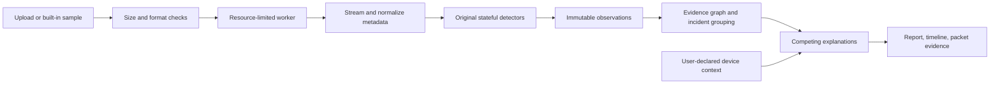

# CausalPacket — Build Plan

**Pitch:** “Fault or Foe? Understand what went wrong, what the packets show, and what to check next.”

**Decision:** Build a local-first packet-capture investigator with original protocol detectors, a temporal evidence graph, competing explanations, and an interactive **Alibi Test**. Use **Python + FastAPI** for analysis and **Next.js + TypeScript + Tailwind CSS** for the interface.

**Implementation status:** Four detector families, gateway/scanner Alibi, packet-backed association, nine captures and the Next.js gateway flow are implemented. AGY reports AGY-004 patched dependencies/browser checks passed and servers stopped. The hardened Python environment passes 111 tests. Report export, serverless demo verification, a demo script and source packaging are ready. Larger generated controls pass, with related scan patterns grouped while preserving all observations and independent faults. [AGY-005](docs/prompts/AGY-005-report-download.md) connects the download UI. Public repository/video/submission remain outstanding; canonical report types are unchanged.

## 0. Competitive review: the recipe for this 20-hour build

**Keep the concept; concentrate the implementation.** The strongest submission tells a beginner what happened, why an explanation fits, what challenges it, and which action to take. Placement cannot be predicted without seeing competing submissions and judging decisions. The rubric gives us a concrete optimization target: technical implementation, security, and video together account for 70%.

The previous plan had three execution weaknesses: it budgeted only two hours for TCP, DNS, scanning, and their tests; it treated useful healthy comparisons as stretch work; and it risked making the Alibi Test look like a whitelist switch. This revision addresses those weaknesses within the same deadline.

Build around **three demonstrations**, each using the real engine:

| Demonstration | What makes it convincing |
| --- | --- |
| Fault versus probing | Similar numbers of connection attempts, but one source retries one unavailable service and another probes many rejected ports. Show the actual diversity/outcome counts and representative successful traffic where available. |
| Explain a gateway transition | Link the changed identity to an affected client using packet evidence; show before/after DNS/TCP outcomes and competing explanations. Approval changes the unauthorized-device hypothesis, while continuing failures remain visible. |
| Know the limits | A one-sided or truncated capture produces incomplete/partial analysis with an explanation. Then a valid sample still works. |

**Judge-visible signature:** one incident panel containing “What happened,” “Why this explanation,” “What challenges it,” and “What to check next.” Clicking any supporting fact opens its frames. Applying context shows **which reason changed and which problem remains**. A compact timeline supports that explanation.

**Value order:** real end-to-end analysis → correct fault/scan distinction → ARP evidence and Alibi → DNS correlation/comparisons → reliability → presentation. Spend spare time on negative controls, a clean setup, and the recorded explanation before expanding detector breadth.

**Scope locks:** four small detector families; two explicit cross-layer association rules; one investigation screen; basic header evidence; three featured scenarios. Keep additional regression fixtures in tests. Full data-retransmission analysis, general graph exploration, DHCP, DNS manipulation, entropy, and elaborate packaging are deferred. A completed, tested implementation is the evidence of technical merit.

## 1. Constraints and target demonstration

- Official development window: **31 October 2026, 21:00 IST → 1 November 2026, 21:00 IST**.
- Working budget: **20 wall-clock hours**, using approximately 31 October, 23:00 IST as the planning anchor. This includes a five-hour rest period, with parallel work when Codex and AGY are both active.
- Internal submission target: **1 November, 19:00 IST**, leaving two hours before the strict deadline. If starting later, shorten scope and work blocks; do not move the official deadline or sacrifice the submission buffer.
- Required submission: public GitHub repository, reproducible setup, included sample captures, README, and a publicly accessible **2–5 minute video** embedded or linked in the README.
- Capture-reading libraries are allowed. **Detection, correlation, and diagnosis logic must be our own.** Do not wrap Wireshark/tshark alerts.
- Use only generated, lab, owned, or explicitly authorized captures. The application does not need live capture privileges.

The central demonstration will be:

1. Load a service-failure capture. Explain repeated connection refusal without declaring an attack.
2. Load a gateway-identity-change capture containing later DNS/TCP problems for a demonstrably related client. Show the observed events, their relationship, and competing explanations.
3. Open **“Could this be something else?”** and mark the second gateway MAC as user-approved. Recalculate the interpretation while retaining identical observations and packet references.
4. Show a capture containing a scan and an independent service fault. Keep both investigations visible.
5. Reject or partially analyze a damaged capture with a clear limitation message.

The novelty is this investigation workflow and its auditable reasoning. We make no claim of inventing causal inference or proving malicious intent from a PCAP.

## 2. Scope and priorities

### P0 — Required working submission

| Capability | Minimum behavior | Primary owner |
| --- | --- | --- |
| Bounded ingestion | Validate PCAP/PCAPNG; stream records; preserve original frame numbers; enforce resource limits; report partial coverage | Codex |
| ARP analysis | Observe conflicting IP/MAC claims and identity transitions; distinguish observations from spoofing hypotheses | Codex |
| TCP analysis | Track handshakes, refusals, unanswered attempts, repeated SYNs, and measured handshake delay; explain observation limits | Codex |
| DNS analysis | Match UDP queries/responses; count SERVFAIL/REFUSED/NXDOMAIN; report delay and unanswered queries with visibility caveats | Codex |
| Scan analysis | Sliding-window destination diversity plus observed connection outcomes; distinguish retries from probing | Codex |
| Incident correlation | Explainable edges based on time, protocol relationships, and shared affected entities; preserve independent findings | Codex |
| Competing diagnosis | Facts, fault/security alternatives, supporting/challenging evidence, missing context, and practical next steps | Codex |
| Comparison evidence | Counts and representative frames for comparable observed successes/failures and before/after behavior; explicitly state when no comparator exists | Codex |
| Alibi Test | Re-evaluate using user-declared gateway/scanner context, reset context, and show what changed | Codex engine; AGY UI |
| Investigation UI | Upload, built-in samples, incident list, timeline/graph, evidence inspector, coverage warnings, report export | AGY; Codex integration |
| Evaluation and samples | Deterministic positive/negative PCAPs, independent assertions, repeatable generation | AGY fixtures; Codex tests/review |
| Submission | Runnable README, actual dependency inventory, demo video, public links, clean setup check | AGY draft; Codex validation; user publishing |

The Alibi Test belongs in P0 because it is the clearest expression of our differentiator. Build it in the second complete slice, immediately after the shared TCP/scan tracker proves fault-versus-probing behavior.

### P1 — At most one addition, only if P0 is green early enough to finish and test it by 11:00 IST

1. **Candidate data retransmissions:** bounded sequence-range tracking with duplicate-capture caveats, independently tested.
2. **MTU evidence:** ICMPv4 type 3/code 4 tied to the quoted original flow. Explain a path-MTU signal; do not diagnose a black hole from large packets alone.

DHCP policy mismatch, conflicting DNS responses, entropy, and general graph exploration are post-submission extensions. Document them as future work, not implemented capabilities. DHCP extensions must account for legitimate multiple offers; DNS extensions need full transaction matching. Their absence is an explicit scope limitation.

The challenge lists example faults and attacks rather than an explicit requirement to implement every example. We prioritize depth in four detector families and document unimplemented categories honestly.

### Out of scope for this event

- Trained ML models, graph neural networks, full probabilistic causal inference, and an LLM chatbot.
- Live sniffing, active probes, full TCP stream reconstruction, IP fragment reassembly, or decrypting traffic.
- Automatic remediation or commands that alter network configuration.
- Accounts, databases, cloud queues, Kubernetes, public upload hosting, and elaborate deployment infrastructure.
- “Confirmed MITM,” calibrated attack probabilities, “false alarms prevented” counters, or “network safe” claims unsupported by evaluation.

## 3. Product and explanation rules

Every incident must provide:

- **Observed:** the packet-derived facts and exact frame references.
- **Assessment:** `likely_fault`, `suspected_attack`, or `unresolved`.
- **Possible explanations:** at least the meaningful alternatives, with support and challenges.
- **Missing evidence:** what the capture and current policy do not establish.
- **Next step:** a concrete verification/troubleshooting action, with a conditional fix where justified.
- **Coverage:** relevant missing directions, truncated records, unsupported protocols, or insufficient observation time.

Example: “Two MAC addresses claimed the configured gateway IP. Possible causes include an address conflict, a gateway transition, or impersonation. Verify both devices against your router configuration. If one is an unintended duplicate, correct its assigned address.”

Keep severity separate from certainty. A serious connectivity failure can still have an unresolved cause. Healthy input displays **“No significant findings in the supported checks,”** accompanied by coverage, rather than a safety certification. A report can contain both fault and suspicious incidents; do not force every capture into one exclusive verdict.

Alibi context is an operator assertion, not authenticated device identity. A MAC/IP match cannot prove a device is benign, and allowing a MAC must not erase continuing service failures or unrelated suspicious behavior.

The context result must show three concise statements: **reason changed**, **evidence retained**, and **remaining problem / next check**. Approval can weaken an impersonation hypothesis; it cannot itself establish that failover caused an outage. A capture can remain unresolved after the Alibi Test.

Recommendation templates must pair a verification step with a conditional remedy. For example: “Confirm the expected service and listener on port 5432; if the service is stopped, start it using your normal service procedure.” Match the action to the evidence and distinguish a refused service from an unanswered request. This directly addresses the rubric's suggested-fix requirement.

## 4. Architecture and repository



The engine must run independently of FastAPI and Next.js. The CLI, API, and sample buttons call the same analysis entrypoint. Samples must be analyzed, not served as prewritten diagnoses.

| Layer | Choice | Reason |
| --- | --- | --- |
| Backend | Python 3.12+, FastAPI, Pydantic, Uvicorn | Typed contracts; patched maintained web dependencies in an isolated environment |
| Capture decoding | Scapy sequential readers inside a worker | Protocol decoding without borrowing another tool's diagnosis |
| Detector state | Bounded dictionaries, sets, deques | Straightforward state machines and window accounting |
| Correlator | Our own small adjacency-list graph | Avoid an unnecessary dependency and retain explainable rules |
| Frontend | Next.js, TypeScript, Tailwind, Lucide | AGY can build presentation against a frozen contract |
| Graph | Small SVG/HTML timeline and explicit relationship labels | Fixed, readable presentation of a few evidence relationships |
| Verification | pytest, API integration checks, browser walkthrough | Protocol correctness and end-to-end proof |
| Storage | Private temporary upload; bounded, expiring in-memory analysis sessions | No database setup; no persistent capture archive |
| Packaging | Python environment + documented frontend command | A dependable local run is the baseline; defer Compose unless all submission work is ready |

Exact dependency versions are selected, installed, and locked during implementation. Add every actual library/API to the README; unused proposed libraries do not belong in the inventory.

```text
PLAN.md
README.md
requirements.txt
backend/
  app.py                 # API routes and bounded session lifecycle
  core/
    models.py            # canonical Pydantic contract
    parser.py            # format validation and record normalization
    worker.py            # subprocess supervision and resource controls
    analyzer.py          # shared orchestration, also used by CLI
    correlation.py       # explicit relationship rules
    diagnosis.py         # explanations and context re-evaluation
    evidence.py          # bounded evidence metadata store
  detectors/
    arp.py
    tcp.py
    dns.py
    scan.py
  cli.py
frontend/
  app/
  components/
  lib/api.ts
  lib/types.ts            # mirrors canonical API models
  fixtures/              # clearly labeled development report fixtures
samples/
  manifest.json          # ground truth, fixture context, expected outcomes
scripts/
  generate_samples.py
tests/
  test_parser.py
  test_tcp.py
  test_dns.py
  test_arp.py
  test_scan.py
  test_correlation.py
  test_diagnosis.py
  test_api.py
docs/
  api-contract.md
  evaluation.md
  demo-script.md
  prompts/               # reviewed AGY work orders
```

## 5. Freeze the contract before parallel implementation

Codex creates canonical Python models, `docs/api-contract.md`, a small valid example report, and matching TypeScript types in Chunk 1. Timebox this to 30 minutes and unblock AGY with one valid report. This section describes the intended contract; the models become the executable source of truth. Include `schema_version` from the start.

| Object | Essential fields |
| --- | --- |
| `PacketEvidence` | `frame_number` (1-based original capture order), `time_offset_seconds`, capture scope, protocol, endpoint addresses/ports, allowlisted header fields |
| `Observation` | Stable ID, type, first/last timestamps, entities, bounded evidence references, total evidence count, measured facts, visibility caveats |
| `EvidenceEdge` | Source/target observation IDs, relation such as `precedes_on_shared_client`, rule ID, plain-language reason, evidence references |
| `Hypothesis` | ID, explanation, `supported`/`plausible`/`insufficient` evidence label, supporting/challenging observation IDs, missing evidence, suggested checks |
| `Incident` | ID, title, assessment, severity, related observation IDs, hypothesis list, next steps |
| `NetworkContext` | Explicit gateway IP, approved gateway MACs, authorized scanner IPs; bounded and validated values |
| `CaptureCoverage` | Seen/decoded/skipped record counts, duration, formats/link types/protocols, unsupported checks, limits reached, visibility notes |
| `AnalysisReport` | Schema version, analysis ID, coverage, immutable observations, edges, incidents, current context, warnings |

Initial API surface:

| Route | Contract |
| --- | --- |
| `GET /api/health` | Small readiness response |
| `GET /api/samples` | Allowlisted sample IDs, descriptions, synthetic-data labels |
| `POST /api/analyze` | One bounded multipart capture, optional validated context JSON field; return an analysis report |
| `POST /api/samples/{sample_id}/analyze` | Analyze an allowlisted repository sample through the same engine |
| `POST /api/analyses/{analysis_id}/reinterpret` | Validated JSON context; return new interpretation from retained observations without re-parsing or mutation |
| `GET /api/analyses/{analysis_id}/evidence` | Bounded frame-ID filter/page; return sanitized header metadata |
| `DELETE /api/analyses/{analysis_id}` | Release the in-memory report and context |

Export a sanitized report from the frontend without adding a separate persistence service. Return structured errors containing a stable code, readable message, and safe details; never a raw traceback or filesystem path.

No background-job framework in P0: supervise the bounded analysis worker while the HTTP request awaits completion without blocking the API event loop. Allow one active parsing worker; reject excess work clearly rather than creating an unbounded queue. Expired analysis IDs return a helpful “analyze again” response.

## 6. Detection and correlation details

### ARP

- Track claims per capture scope and IPv4 address; collect sender MACs, transition times, request/reply behavior, and frame references.
- Ignore `0.0.0.0` probe sender addresses as ownership claims. Do not infer a gateway from an address ending in `.1`.
- Two different MAC claims establish conflicting observed identity information. A sequential change does not establish simultaneous duplicate ownership or malicious intent.
- Unsolicited replies are a supporting observation, with legitimate announcement/failover alternatives.
- A configured gateway plus a policy-unapproved claimant supports a suspected impersonation hypothesis; policy absence must remain explicit.
- The Alibi Test weakens the unauthorized-device hypothesis when appropriate while retaining address changes and residual failures.

### TCP

- Track directional connection attempts using endpoints, ports, initial sequence number, and bounded lifetime; match the reverse direction.
- Deduplicate repeated SYNs for scan accounting. A matching SYN-ACK means a response was observed; a matching final ACK establishes an observed handshake completion.
- Distinguish matching RST refusal, repeated SYN, delayed response, and unanswered attempt. Avoid accepting unrelated RST/ACK traffic as a matching outcome.
- P0 retransmission coverage is repeated SYN attempts. General data-segment retransmission analysis is P1; if implemented, use sequence ranges, payload length, direction, and time, and explain that identical captured segments may be duplicate capture records. Do not advertise general TCP retransmission coverage without it.
- Do not label every reset a fault; aggregate failed attempts and relevant context.
- At the end of a capture, pending attempts without enough observation time are **incomplete**, not failed. Capture absence is not proof of network absence.

### DNS

- Match by scope, transport, client/resolver addresses, client/server ports, transaction ID, normalized question name, type/class, and a bounded time window.
- Handle repeated requests without inflating independent failures; keep request, response, and latency evidence.
- Report SERVFAIL/REFUSED separately. NXDOMAIN alone is not an attack and occasional NXDOMAIN is a normal negative control.
- Treat unanswered queries near capture boundaries as incomplete. Missing responses in one-sided captures remain uncertain.
- P0 supports decodable UDP DNS. TCP DNS requiring reassembly, encrypted DNS, and fragmented messages are explicitly outside diagnostic coverage.

### Scans

- Initial demonstration settings: a **10-second window**, **12 distinct destination ports to one target** or **12 target hosts on one service**, at least **10 attempts with observed outcomes**, and **80% explicitly rejected outcomes**.
- These are configurable prototype heuristics, not universal or validated security thresholds.
- Outcomes, unanswered attempts, and completed handshakes must be shown separately. Count a SYN-ACK as a responsive service for scan reasoning even if the initiator does not finish the handshake.
- Diversity with too few observable outcomes can yield unresolved probing activity; do not manufacture an 80% failure rate from missing packets.
- Repeated retries to one port are not a diversity-based scan. Many successful service connections are a negative control.
- An authorized-scanner context changes the interpretation to approved probing activity while keeping the observations and remaining limitations.

### Correlation and differential reasoning

- Implement just two cross-layer association rules initially: **gateway identity transition ↔ client-linked transport/DNS degradation**, and **resolver failures ↔ subsequent connection attempts from the same client with additional observed linkage**. The second rule requires a relevant observed DNS answer-to-destination mapping; without one, leave the findings separate. DNS failure alone cannot identify the destination a client intended to connect to. Neither rule establishes causation.
- For comparison evidence, keep bounded outcome counters and representative frames per client/service/resolver and incident interval. Prefer same client and service before/after; alternatively compare clients reaching the same service in a nearby window and state that difference. Display raw counts and the comparison basis. Broad claims such as “the network was healthy before” require broader evidence than one successful flow.
- Start with a configurable **5-second association window**. Measure distance between relevant event times/intervals rather than treating an entire long capture as one window.
- An edge requires a specific rule plus relevant shared entities in the same capture scope. Time adjacency alone, a common broadcast address, or a shared public DNS server is insufficient.
- For a gateway claim and later client failures, require evidence connecting that client to the gateway claim, such as a targeted ARP reply or observed client frames addressed to the claimant MAC. Otherwise retain separate findings and state that the connection is unknown.
- Use a gateway-transition observation's actual change timestamp, not its earliest historical MAC claim, when comparing subsequent events.
- Record rule IDs and reasons on edges. Render **“temporally associated”** and **“shares affected client”**, never “proved cause.”
- Group compatible observations into bounded investigations; prevent transitive chaining through unrelated clients or indefinitely extending windows. Independent incidents in the mixed sample stay independent.
- If a directed display is used, order by `(event_time, stable_id)` to make it acyclic. Direction represents evidence chronology, not proof of causation. Overlapping events can be described as associated without a causal arrow.
- Prefer a candidate explanation only when its documented evidence requirements are met. Emit unresolved when no explanation is sufficiently supported.
- Reinterpretation reads immutable observations and context. It does not delete observations, change frame numbers, or silently hide “downstream” findings.

## 7. Safe ingestion and privacy

Initial limits below are implementation targets to verify on the development machine, then document accurately:

| Resource | Target |
| --- | --- |
| Upload size | 25 MiB, counted during request ingestion rather than trusted from `Content-Length` |
| Packet records examined | 100,000, counting undecodable records too |
| Worker wall time | 15 seconds, enforced by the supervising parent |
| Worker CPU / address space | 10 CPU seconds / 512 MiB address-space cap on Linux, measured and adjusted if needed |
| Concurrent parsing workers | 1 |
| Sessions retained | At most 3, 30-minute expiry, with a total serialized-data budget |
| Retained state/output | Explicit caps for flow/query tables, observations, graph edges, packet metadata, strings, and response bytes |

Required behavior:

1. Recognize all four standard classic-PCAP byte-order/precision signatures and PCAPNG's section-header signature. Validate structure as well as magic; reject archives/compressed uploads in P0.
2. Bound record/block lengths before decoding or allocating from declared lengths. Check against remaining file size, container structure, and a documented per-record cap. Do not assume `PcapReader` itself supplies every required bound.
3. Stream records into normalized events. Do not retain full Scapy packet objects or use `rdpcap()` for application ingestion. Streaming plus bounded tables is **bounded memory**, not automatically constant memory.
4. Establish a P0 support floor of Ethernet/IPv4/ARP and ordinary Ethernet PCAPNG. Scope ARP state by available section/interface/VLAN identity; if reliable scope cannot be obtained, report the unsupported multi-interface case instead of combining claims. Other link types/protocols get explicit coverage messages.
5. Preserve original packet-record numbering even when a record cannot be decoded. Non-packet PCAPNG blocks do not increment frame numbers. Track packet counts separately from container blocks.
6. Skip a packet decoding error only when its record boundary is trustworthy. Stop with partial-analysis warning on unrecoverable framing corruption; arbitrary resynchronization risks inventing evidence. Keep the valid prefix when safely available.
7. Enforce time/memory limits in a fresh worker, not just elapsed-time checks inside the loop. Terminate and reap the worker on timeout. On a hard kill, report a failed/limited analysis unless a valid checkpoint was explicitly implemented; do not promise a partial report that was never produced.
8. Cap the upload body before multipart parsing can spool unbounded data. Use private generated temporary filenames, bounded metadata headers, a small allowlisted multipart shape, and cleanup on success, failure, cancellation, and startup after an interrupted run.
9. Bind locally, use explicit development origins, and use a non-root process. The worker is resource-isolated; do not advertise a complete security sandbox without tested OS-level network/filesystem isolation.
10. Extract header metadata through an allowlist. Do not save raw payloads, packet hex dumps, HTTP headers/cookies, credentials, or automatic Scapy summaries. DNS names and addresses can also identify users: redact query names by default in export and explain which metadata remains. No third-party inference calls or raw-packet logging.
11. Delete uploaded bytes when analysis finishes. Keep only capped metadata needed for evidence/reinterpretation, with expiry/reset controls; never use browser storage for packet captures.
12. Treat packet strings as untrusted UI text. Escape normally, limit lengths, validate IP/MAC settings, and avoid HTML injection or automatic links from captured content.

## 8. Work split and collaboration protocol

**Codex owns the difficult logic:** contracts, ingestion supervision, protocol state machines, correlation, diagnosis, Alibi semantics, API behavior, and independent correctness/security tests.

**AGY owns bounded implementation tasks:** frontend scaffold and components, fixture generation, repetitive display wiring, README/demo drafts, and optional packaging. AGY receives exact inputs and acceptance checks instead of deciding detector semantics.

**User coordinates:** relay AGY prompts/results, confirm external submission details, record/upload the video, and submit the form. Local development continues without repeatedly requesting approval for routine implementation choices.

Shared-workspace rules:

- Assign one owner per file for each chunk. AGY does not edit `backend/**`, canonical schemas, or Codex tests unless a later work order explicitly assigns it.
- Codex creates `frontend/lib/types.ts` initially. AGY reads it and never changes its shape independently; contract changes go through Codex first.
- Do not overwrite another worker's changes or run broad formatting/scaffolding over existing directories.
- Each handoff includes changed files, exact run commands, checks and results, assumptions, and unresolved issues. Codex reviews and verifies before marking complete.
- UI fixtures are visibly marked development data. Finished sample buttons must call the engine; they cannot present a mock report as analyzed evidence.
- Keep tasks short enough to review independently. The next prompt is based on the actual integrated state, not a long speculative batch.

### Chunk sequence

| Chunk | Codex work | AGY work | Completion gate |
| --- | --- | --- | --- |
| 1: Contract | Canonical models, API spec, TypeScript types, representative report | Frontend scaffold, layout, upload/sample controls, fixture-driven incident view | Types and fixture agree; frontend builds |
| 2: First vertical slice | Bounded ingestion, shared TCP/scan tracker, diagnosis, minimal API | Healthy/service/scan sample generator; wire real report UI | Upload → real fault/scan explanation → exact frames; no mock dependency |
| 3: ARP and Alibi | ARP tracker, context re-evaluation, immutable-evidence checks | Gateway transition sample and Alibi panel | Context changes a documented reason; original facts and residual failures persist |
| 4: Broaden detection | UDP DNS tracker, comparison counters, two association rules, independent tests | Remaining regression fixtures and manifest | DNS and mixed capture expectations pass; comparable observations shown where present |
| 5: Investigation and reliability | Evidence/API integration, malformed/limit tests, privacy checks, clean run | Timeline, evidence drawer, comparison details, coverage, context reset, export, README draft | Every claim resolves to evidence; documented setup works; graceful errors |
| 6: Submission | Final regression, measured evaluation, honest feature inventory | Demo-script polish | Public repo, samples, README, verified public video, form submitted before deadline |

### First copy-paste AGY work order

Send after Codex completes Chunk 1's canonical types and example report:

```text
We are building CausalPacket for the IIITDM cybersecurity hackathon.
Your task is the Next.js frontend shell only; Codex owns the analysis engine.

Read PLAN.md, docs/api-contract.md, frontend/lib/types.ts, and the supplied
example report before editing. If a required contract file is absent, report
that dependency; do not invent an incompatible API shape.

Allowed changes: frontend/** except frontend/lib/types.ts. Preserve existing
files and adapt the scaffold to them. Do not edit backend/**, tests/**,
PLAN.md, sample captures, or the API contract.

Build a compact, responsive investigation workspace with:
- CausalPacket identity and the subtitle “Fault or Foe?”
- PCAP/PCAPNG upload and built-in scenario controls.
- Capture packet count, duration, incident count, and coverage state.
- Incident list and detail showing observed facts, competing explanations,
  missing evidence, and next steps.
- Comparison details using only provided observed counts and frame references.
- A simple evidence timeline and a header-only frame-evidence drawer.
- An Alibi Test form for explicit gateway IP, approved gateway MACs, and
  authorized scanner IPs, with Apply and Reset context controls.
- After context changes, show the supplied changed reason and any continuing
  problems. Never turn approval alone into a claim that the cause is proven.
- Loading, empty, partial-analysis, expired-session, and error states.

Use Next.js + TypeScript + Tailwind; use Lucide where helpful. Keep graph
rendering simple. Use typed data and an isolated API adapter. Until the API
is ready, use only the supplied report fixture and visibly label it as
development fixture data. Keep the eventual live adapter easy to connect.
Never show fabricated attack percentages, “confirmed MITM,” “network safe,”
“false alarms suppressed,” raw payloads, or automatic repair commands.
Render all captured text as plain escaped text. Make controls accessible
by keyboard and keep the layout usable on a narrow screen.

Acceptance: run the frontend's typecheck/build; exercise incident selection,
evidence selection, and context form behavior with the supplied fixture.
Report changed files, commands and outcomes, and remaining integration work.
Do not claim backend functionality or verification you did not perform.
```

Later work orders use the same structure: objective, exact allowed files, dependencies, behavior, prohibited contract changes, verification, and handoff requirements.

## 9. Samples and evaluation

Generate deterministic captures using documentation IPv4 ranges (for example `192.0.2.0/24`, `198.51.100.0/24`, `203.0.113.0/24`), locally administered MACs, fixed times/sequences, and `.test` names. Generation writes files only; never send crafted packets onto a network. Include the actual PCAPs as well as the generator.

| Capture | Expected behavior |
| --- | --- |
| `01_healthy.pcap` | Completed TCP handshakes and successful DNS; no significant findings |
| `02_service_failure.pcap` | Repeated correctly matched connection refusals; fault-oriented explanation; no scan |
| `03_possible_scan.pcap` | Many distinct rejected probes; suspected scan with exact counts and threshold explanation |
| `04_gateway_transition.pcap` | ARP identity change plus client-linked DNS/TCP problems; competing explanations; Alibi changes interpretation only |
| `05_mixed_scan_and_fault.pcap` | Independent scanner and failed service; both findings survive correlation |
| `06_dns_faults.pcap` | DNS failures and latency; isolated NXDOMAIN remains a negative control |
| `07_truncated.pcap` | Intentionally damaged container; valid-prefix warning or controlled rejection, according to damage location |

Also create small test fixtures for valid PCAPNG, both byte orders/precision variants, ARP context changes, and malformed inputs. Each sample manifest includes generator seed/version, synthetic label, optional **explicitly applied** context, expected observation types, forbidden conclusions, and important frame relationships. Do not silently load a sample's privileged context into a user upload.

Tests must independently check:

- TCP direction/sequence matching, SYN retry deduplication, refusal versus midstream reset, completed handshake, delayed response, and capture-tail incompleteness. Test repeated data segments if that P1 feature is implemented.
- DNS identical transaction IDs across different clients/questions, retry behavior, correct resolver matching, normal NXDOMAIN, and missing-response uncertainty.
- ARP `0.0.0.0` probes, a legitimate single announcement, conflicting claims, configured versus unknown gateway, and no mixing of different network scopes.
- Many successful connections versus rejected probes, one-port retries, sliding-window expiry, and a minimum sample size for outcome ratios.
- Correlation with shared affected clients versus unrelated events at the same timestamp; no suppression of independent incidents or loss of evidence.
- Alibi apply/reset: exact same observations, frame references, and measured counts before/after; changed hypothesis reasons; residual faults retained.
- Wrong magic, empty/header-only file, incomplete record, unsupported link type, excessive declared block length, upload/packet/state/output limits, timeouts, worker failure, cleanup, and API responsiveness afterward.
- API sample allowlisting, validation, expired sessions, bounded evidence access, and UI error handling.
- Synthetic credentials placed in test payloads never appear in API reports, logs, evidence displays, or exports. Include untrusted strings to verify escaped rendering.

Write `docs/evaluation.md` from actual runs: scenario outcomes, known limitations, machine description, analysis duration, and peak resource measurements where collected. Keep tuning captures separate from a small set of varied regression fixtures. Never claim production accuracy from this synthetic suite.

Before the recording, run a **fixture-independence check**: regenerate cases with changed IPs, MACs, source ports, and time offsets; vary timing around the documented thresholds. Diagnosis must follow packet behavior rather than filenames or hardcoded demo identities. Check changed classification only where the documented rule boundary changes. Publish expected-versus-actual outcomes, including misses and unresolved cases. This provides stronger evidence than replaying the exact files used while writing the rules.

## 10. Twenty-hour execution schedule

Times below assume the 23:00 IST planning anchor. Codex and AGY tasks overlap within each active block; the rows are wall-clock time, not additive person-hours.

| IST window | Deliverable | Gate / fallback |
| --- | --- | --- |
| 31 Oct 23:00–23:30 | Freeze minimal contract and ownership; AGY starts UI shell | One valid report and matching types; stop expanding the design |
| 23:30–1 Nov 02:00 | Bounded ingestion and shared TCP/scan tracker; real API/UI slice | Real service-failure and scan captures produce distinct explanations with frame evidence |
| 02:00–04:00 | ARP tracker, competing explanations, Alibi apply/reset | Reason changes are explicit; observations and residual failures persist |
| 04:00–09:00 | Protected rest block | Save runnable state and next work orders; do not assume unattended AGY progress |
| 09:00–11:00 | UDP DNS, limited correlation rules, comparison evidence, full UI integration | Four focused detector families; working complete demonstration |
| 11:00–13:00 | **Feature freeze**; parser hardening, negative controls, varied fixtures, privacy checks | Fix correctness; cut P1 work; record real evaluation outcomes |
| 13:00–15:00 | Clean setup, README, rehearsal, presentation fixes | A complete rehearsal recording exists by 15:00 |
| 15:00–17:00 | Record final 3–4 minute video, upload, check public playback | Video accessible without signing in; README link correct |
| 17:00–19:00 | Final regression, repository visibility, contingency, submission form | Submit as soon as ready, by 19:00; preserve confirmation |
| 19:00–21:00 | Submission contingency buffer | Official deadline remains strict; no dependence on last-minute pushes |

The schedule retains five hours of rest and gives TCP/scan implementation a dedicated early block. It is an allocation within the original 20-hour budget, not a fresh 20-hour clock after each review. The user can move the rest block while preserving the integration and recording gates.

**Hard fallback gates:** if the real UI/API slice misses 02:00, simplify the UI immediately to upload, result cards, and evidence; if DNS/correlation misses 11:00, ship tested individual diagnoses and the ARP Alibi rather than rushing unsupported links; if a full rehearsal misses 15:00, freeze styling and record the working path. Preserve bounded ingestion and truthful evidence through every cut.

Scope reduction order if behind: P1 additions → export/UI extras → second correlation rule → visual polish. Keep the Alibi Test, a readable timeline/table, frame references, supported detector checks, and safe errors. Simplify the existing frontend rather than introduce a second UI framework.

## 11. Rubric alignment and demo

| Criterion | Weight | Concrete proof |
| --- | --- | --- |
| Novelty | 20% | Competing hypotheses, observed comparisons, and Alibi with explicit changed reasons and residual faults |
| Technical implementation | 30% | Original protocol state machines, explicit graph rules, negative controls, independent tests |
| Security | 20% | Bounded worker/ingestion, malformed-input handling, metadata-only retention, privacy checks |
| Feasibility | 10% | Clear local setup, generated samples, no API keys, clean-run verification |
| Video | 20% | Actual fault versus suspicious case, packet evidence, Alibi, limitation handling |

Suggested 3 minute 40 second script:

| Time | Show |
| --- | --- |
| 0:00–0:20 | Problem: an ordinary outage and an attack can look similar |
| 0:20–0:55 | Real service-failure analysis; explain why retries/refusal do not establish an attack |
| 0:55–1:55 | Gateway transition investigation, related observations, competing explanations, exact frames |
| 1:55–2:35 | Alibi apply/reset; changed assessment and unchanged packet facts |
| 2:35–3:05 | Mixed fault/scan capture; independent incidents remain visible |
| 3:05–3:25 | Controlled malformed-input behavior and coverage limitations |
| 3:25–3:40 | Setup, included samples, original engine, and project link |

README must cover the problem, implemented features, exact setup/run commands, samples, original-versus-library responsibilities, dependency/API inventory, architecture, test/evaluation results, privacy/resource behavior, limitations, and public video link. Do not leave placeholder video links in the final submission.

Final checks: repository is public; included samples regenerate; documented commands work; tests/build pass; video runs 2–5 minutes and plays anonymously; no private captures or secrets are committed; links resolve; team leader submits the correct form before 21:00 IST. Verify the actual submission-form URL from the organizer's announcement; it was not included in the pasted statement.

## 12. Verified technical references and claim boundaries

These sources inform the design; they do not validate our eventual implementation or its detection accuracy.

- [Sherlock / multi-level dependency inference — Microsoft Research, SIGCOMM 2007](https://www.microsoft.com/en-us/research/publication/towards-highly-reliable-enterprise-network-services-via-inference-of-multi-level-dependencies/): inspiration for linking observations across layers. Our small rule-based evidence graph is not a reproduction of Sherlock's inference system.
- [Lakhina, Crovella, Diot — Mining Anomalies Using Traffic Feature Distributions, SIGCOMM 2005](https://conferences.sigcomm.org/sigcomm/2005/paper-LakCro.pdf): feature distributions and entropy can help characterize anomalies. This does not justify a universal “high entropy = attack” rule; entropy remains optional here.
- [RFC 5227 — IPv4 Address Conflict Detection](https://www.rfc-editor.org/rfc/rfc5227): conflict detection and legitimate ARP announcements inform cautious interpretation. A changed claim is not proof of spoofing.
- [RFC 9293 — TCP](https://www.rfc-editor.org/rfc/rfc9293.html): basis for handshake/reset semantics; our capture-based heuristics still need explicit visibility limitations.
- [RFC 2131 — DHCP](https://www.rfc-editor.org/rfc/rfc2131): multiple server offers can be normal. A DHCP extension must inspect policy/configuration rather than count servers alone.
- [Scapy reader APIs](https://scapy.readthedocs.io/en/latest/api/scapy.utils.html): sequential PCAP/PCAPNG decoding primitives; additional application resource controls remain our responsibility.
- [IETF PCAP format draft](https://datatracker.ietf.org/doc/html/draft-ietf-opsawg-pcap): format guidance, including timestamp precision/byte ordering. It is an Internet-Draft, not a finalized RFC.
- [Python resource controls](https://docs.python.org/3.12/library/resource.html): Unix resource-limit mechanisms. Platform support and actual enforcement must be tested; a subprocess alone is not a full sandbox.

Do not carry the supplied proposals' CTGAD-X/TOCA-IoT implementation claims, “96% confidence,” or guaranteed-winning language into the README. Additional related work can be added after checking the primary paper and clearly distinguishing it from what we implemented.

## 13. Definition of done and immediate next action

The project is complete when a judge can follow the README, analyze included and uploaded supported captures, inspect accurate frame evidence, compare meaningful explanations, apply/reset context without altering observations, and receive controlled errors or limitations for damaged/unsupported input. Independent tests, sample files, evaluation notes, and a publicly accessible demo must accompany that working product.

**Immediate next action:** Relay [AGY-005](docs/prompts/AGY-005-report-download.md), then freeze features and rehearse the recorded demo. Verify with run.sh check and verify-demo, rebuild the source snapshot after final changes, and complete real repository/video publication and team-leader submission. Close servers after verification/recording. Detector breadth remains frozen.
