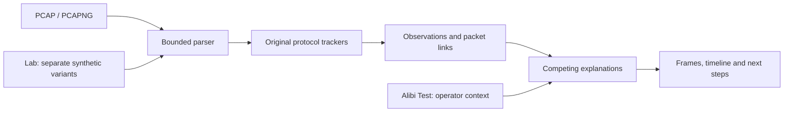

# CausalPacket · Fault or Foe?

> **The network is broken. Is it a fault, suspicious activity, or too early to tell?**

Small offices and campus labs often have no network specialist. Outages and
attacks can produce similar packet symptoms, leaving beginners unsure what to fix.
**CausalPacket turns a capture into an understandable investigation:** observed
facts, competing causes, exact packet references and practical next checks.

Built for the **IIITDM Kancheepuram Cybersecurity Hackathon · Network Track · 2026**.

**[▶ Watch the 2:43 captioned demo](docs/demo.mp4)** ·
[Live app](https://causal-packet.vercel.app/) ·
[Voice-over script & new-UI recorder](docs/demo-script.md) ·
[Example investigation](docs/example-investigation.md) ·
[Evaluation](docs/evaluation.md)

The video combines a recorded UI walkthrough with labeled, measured synthetic
experiment results. The walkthrough shows the earlier interface layout.

## Our contribution

| Distinctive workflow | Demonstration |
| --- | --- |
| **Alibi Test: challenge the interpretation** | Approve a verified backup gateway; suspicion changes while packet facts and unresolved service problems remain. |
| **Evidence lab: challenge the evidence** | Reanalyze modified synthetic captures; missing replies can weaken a scan assessment. |
| **Packet-backed cross-layer grouping** | Link ARP/DNS/TCP observations using actual next-hop MAC evidence; keep independent faults visible. |

Our originality is this implemented combination for beginners. Detection,
timelines and dependency graphs are established ideas; we make no first-ever
claim. [Research context and measured experiments →](docs/novelty.md)

## Run it

**Requirements:** Linux or WSL, Python **3.12+**, Node.js **20.9+**, and pnpm.
From the repository root:

```bash
./run.sh setup
./run.sh dev
```

Open **<http://localhost:3000>**. Choose a bundled synthetic capture or upload an
uncompressed `.pcap` / `.pcapng`. No API key, database, or capture privileges are
needed. Setup downloads dependencies; analysis runs locally. **Ctrl+C stops both services.**

[CLI, separate terminals and troubleshooting →](docs/running.md)

[Host the demo on Render + Vercel →](docs/deployment.md)

## Try the Alibi Test

Choose **Gateway identity investigation**. Two MAC addresses claim one IP, with
packet-linked DNS errors and TCP refusals. Then apply the sample inventory and
approve the second MAC as an authorized gateway device.

| Context supplied by the operator | Assessment |
| --- | --- |
| No gateway inventory | **Unresolved** |
| Known gateway; second claimant unapproved | **Suspected attack** |
| Both gateway MACs approved | **Unresolved** — service problems remain |

> **Same packets. Different interpretation.** The Alibi Test changes the trusted
> context while retaining observations, measurements and evidence. Approval does
> not authenticate a device or prove why the failures occurred.

**[Experimental evidence lab](docs/novelty.md):** rerun modified synthetic captures
to test missing replies, irrelevant traffic removal, and unsupported gateway
links. Thirty controlled variants exercise when conclusions should change. Open
the optional evidence lab in the interface and explicitly run an experiment.

## What it investigates

| Family | Observations and interpretation |
| --- | --- |
| **TCP** | Refused connections, possible SYN retries, unanswered attempts and handshake delays |
| **Scanning** | Many ports/hosts contacted within a window, interpreted alongside observed outcomes and scanner authorization |
| **ARP** | IP-to-MAC identity changes, with duplicate-address, failover and impersonation explanations |
| **UDP DNS** | Matched resolver errors, missing replies and response delays; ordinary NXDOMAIN is not attack evidence |

Findings include competing explanations, missing evidence, practical next steps,
frame references, a timeline, and Markdown/JSON exports. Independent faults stay
visible when related observations are grouped.

**Outside current coverage:** MTU diagnosis, rogue DHCP, DNS hijacking, encrypted
traffic analysis, general TCP data retransmissions, and full stream reconstruction.

## How it works



**Next.js → FastAPI → resource-limited Python worker.** Scapy decodes packets;
our code implements tracking, detection, grouping and diagnosis. No Wireshark/
tshark diagnosis output or external inference API is used. Packet links support
association; they do not prove causation.

<details>
<summary><strong>Research foundations · three papers that informed the design</strong></summary>

| Paper | Idea adapted in our implementation |
| --- | --- |
| **Chen et al., SIGCOMM 2016:** [The Good, the Bad, and the Differences: Better Network Diagnostics with Differential Provenance](https://haeberlen.cis.upenn.edu/papers/diffprov-sigcomm2016.pdf) | Compare failing behavior with a relevant successful example. We retain earlier successful exchanges as explicit comparators. |
| **Bahl et al., SIGCOMM 2007 — Sherlock:** [Towards Highly Reliable Enterprise Network Services via Inference of Multi-level Dependencies](https://www.microsoft.com/en-us/research/publication/towards-highly-reliable-enterprise-network-services-via-inference-of-multi-level-dependencies/) | Consider relationships across layers. Our conservative rules group packet-linked observations into investigations. |
| **Jung et al., IEEE Security & Privacy 2004 — TRW:** [Fast Portscan Detection Using Sequential Hypothesis Testing](https://people.csail.mit.edu/awberger/papers/fastPortscanDetectionUsingSequentialHypothesisTesting_JungPaxsonBergerBalakrishnan_2004.pdf) | Connection outcomes matter alongside probe diversity. Our scan heuristics require sufficient observed outcomes before raising suspicion. |

These are design inspirations, not reproduced algorithms: we do not implement
DiffProv's provenance reconstruction, Sherlock's probabilistic inference, or TRW's
sequential hypothesis test. Our detection and diagnosis logic is original,
deterministic Python; the Alibi Test and evidence lab are our project contributions.

</details>

## Reproducible checks

**156 backend tests passed · 9 synthetic demo scenarios passed · TypeScript and
Next.js production build passed.** These controls do not establish production
accuracy or a calibrated probability of attack.

```bash
./run.sh check
./run.sh verify-demo
```

| Included scenario | What to look for |
| --- | --- |
| Service failure | 12 connection refusals and an earlier successful exchange |
| Scan and independent fault | Two investigations; scanner approval preserves the service fault |
| Gateway identity investigation | Explicit inventory, Alibi transition and unchanged packet facts |
| Healthy and damaged captures | Honest empty findings or partial coverage, respectively |

All **[nine captures](samples/)** are generated offline using fictional addresses.
[Ground truth](samples/manifest.json) · [Measured evaluation](docs/evaluation.md) ·
[API contract](docs/api-contract.md)

## Security and limits

- **Bounded work:** 25 MiB uploads, 100,000 packet records, bounded tracking/report
  state, and a worker with a 15-second wall timeout plus CPU/memory limits.
- **Local metadata handling:** uploaded bytes are deleted after processing;
  reports omit raw application payloads but retain potentially sensitive IP/MAC
  headers. Metadata sessions are bounded and expire after 30 minutes.
- **Honest uncertainty:** unsupported or damaged input carries coverage notes.
  An empty finding list does not certify safety. Worker resource limits are not
  a complete OS security sandbox; the default configuration is for local use.

Use synthetic captures or traffic you are authorized to analyze. The application
performs no live sniffing, probing, or automatic network repair.

<details>
<summary><strong>Open-source libraries and versions</strong></summary>

| Layer | Libraries used |
| --- | --- |
| Backend | FastAPI, Starlette, Pydantic, pydantic-core, Uvicorn, Scapy, python-multipart, AnyIO |
| Supporting Python packages | annotated-doc, annotated-types, Click, h11, idna, opentelemetry-api, typing-extensions, typing-inspection |
| Test tooling | pytest, HTTPX, httpcore, certifi, iniconfig, packaging, pluggy, Pygments; optional React Test Renderer and Playwright verification |
| Visual assets | Original generated logo/illustration via OpenAI image generation; locally hosted Manrope and Space Grotesk fonts (SIL OFL). [Asset notes](frontend/public/brand/README.md) |
| Demo tooling | FFmpeg / ffprobe for captions, measured-result slides and video validation; not required to run the app |
| Frontend | Next.js, React, React DOM, TypeScript, Tailwind CSS, PostCSS, Autoprefixer, Lucide React, @types/node, @types/react, @types/react-dom |

Exact versions: [Python inventory](docs/dependencies.md),
[runtime pins](requirements.txt), [test pins](requirements-dev.txt),
[frontend declarations](frontend/package.json) and [lockfile](frontend/pnpm-lock.yaml).
Recorded advisory checks and their limitations: [dependency audit](docs/dependency-audit.md).

</details>

[Rules and readiness review](docs/hackathon-review.md) ·
[Submission status](docs/submission-status.md)
